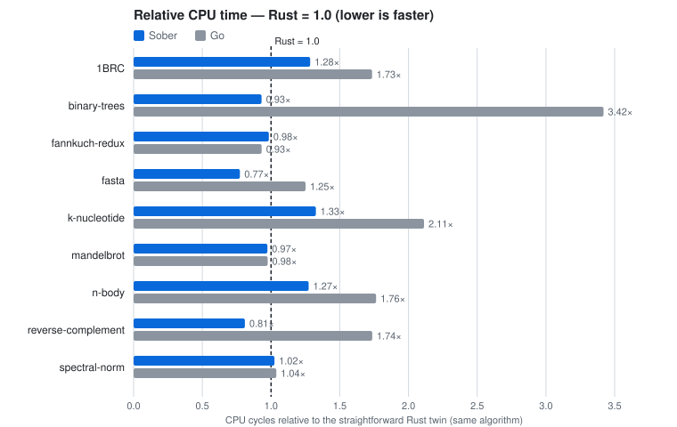
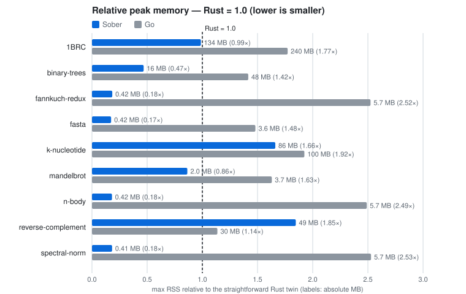

# Sober

[English](README.md) | 日本語

値指向のプログラミング言語。

Soberのプログラムが名前で扱うのは、値と可変の束縛だけです。参照やポインタの型はありません。ブロックの外から中の値を指すものを作れないので、値の寿命はブロックで決まります（region）。GCも借用検査も要りません。不変の値は、コピーしたか共有したかをプログラムから観測できません。そのため、値の渡し方と置き場所は処理系が選べます。→ [値指向とは](docs/value-oriented.ja.md)

静的型付け（型推論つき）・式指向で、AOTコンパイルがネイティブの静的ELFを直接出力します。GCはありません。Goライクな構文です。

```sober
// examples/collatz_par.sober
package main

import "std/iter"
import "std/task"

type TooLarge error {
    n int
}

// Collatz steps (expression-oriented: if has a value)
func steps(n int) (int, error?) {
    if n > 1000000000 {
        return 0, TooLarge{n: n}
    }
    mut x := n
    mut k := 0
    while x != 1 {
        x = if x % 2 == 0 { x / 2 } else { 3 * x + 1 }
        k += 1
    }
    return k, nil
}

func main() int {
    mut ns := mut []int{}
    for i <- iter.Range(1, 1000001) {
        ns = append(ns, i)
    }
    // a parallel Map — the output is the same for any number of workers
    ks, err := task.Map(ns, (n) => steps(n) catch -1)
    if err != nil {
        return 1
    }
    mut best := 0
    for k <- ks {
        if k > best {
            best = k
        }
    }
    println("longest: ${best}")
    return 0
}
```

HTTPサーバも標準ライブラリだけで書けます（TLS 1.3もstdにあります）:

```sober
// examples/http_hello.sober
package main

import "std/http/server"
import "std/net"

func hello(r http.server.Request) http.server.Response {
    n := http.server.Param(r, "name")
    return http.server.Text("hello, ${if n != nil { n } else { "world" }}\n")
}

func app(c net.Conn) error? {
    rs := []http.server.Route{http.server.Route{method: "GET", path: "/hello/:name", handler: hello}}
    return http.server.ServeConn(c, (r) => http.server.Dispatch(rs, r))
}

func serve() error? {
    for l <- net.Listen("127.0.0.1:8080")? {
        net.Serve(l, app)?
    }
    return nil
}

func main() int {
    if serve() != nil {
        return 1
    }
    return 0
}
```

## 値指向から導かれる性質

Soberの値指向は、次の2つの約束を指します（詳しくは[値指向とは](docs/value-oriented.ja.md)）。

- 参照は値になりません。番地や参照を取り出して、保存したり渡したりする手段がありません。
- 不変の値は、コピーしたか共有したかを観測できません。

この2つから、次の5つの性質が導かれます。

- 逃げる参照が書けない。参照は値にならないので、解放済みの領域を指す形を作れません。値の寿命はブロックで決まり、ブロックを出る値はコピーされます。全ブロックがregionです（[規則](docs/spec/09-memory.ja.md)）。GCも借用検査も要りません。
- データ競合が書けない。可変の値はtaskの境界を越えません。並列スコープに渡せるのは不変値かチャネルだけです（[規則](docs/spec/10-concurrency.ja.md)）。
- 寿命の注釈も借用の規則も無い。参照が無いので、書く必要がありません。学ぶのは「書けないこと」だけです。書けない形（domainを通さない共有の可変・逃げる参照）がコンパイルエラーになります。
- 速いコードを書くための作法が無い。値を参照で渡すかコピーで渡すか、どこに置くかは、処理系が選びます。プログラマーが選ぶ所ではないので、素直に書いたコードが最速の形です。
- 並列にしても出力が変わらない。taskは可変の状態を共有しないので、ワーカー数を変えても出力はバイト単位で同じです。

## 4本の柱

### 安全

- メモリ安全かつデータ競合なし。GCも借用検査も使いません。これは値指向から導かれます（上の節）。
- エラーの取りこぼしを拒否する。解析器が呼び出しのグラフからエラーをラベルの集合として導出し、公開の境界では宣言を求めます（[規則](docs/spec/07-errors.ja.md)）。

→ [なぜ安全か](docs/design-notes/safe.md)

### 高速

- 素直に書いたコードが速い。これは値指向から導かれます（上の節）。速さのための機構はランタイムとコンパイラの中にだけ置き、ベンチマークのSober側も素直な形に限っています。
- Rustに匹敵する実行速度。同じアルゴリズムの素直なRustと比べて、逐次9題材で勝ち4・互角3・負け2（負けはreverse-complement 1.47×・n-body 1.17×）。Goには6勝3互角（負けなし）です。 <!-- benchsync:readme-speed-ja -->
- Rust並みのメモリフットプリント。GCはありません。最大RSSは9題材中8題材でRust以下です（上回るのはk-nucleotide）。 <!-- benchsync:readme-rss-ja -->
- taskが軽い。2026-10-10の計測で、[Skynet](bench/skynet) の111万taskがGoの5倍速く動きました。

→ [なぜ速いか](docs/design-notes/fast.md)

### 平凡

- 式指向のふつうの手続き型。if / switch / ブロック / forが値を持ちます（[規則](docs/spec/04-expressions.ja.md)）。Goを読める人なら読めます。
- メソッドも型クラスもマクロもない。言語を小さく保つための選択です。このうちメソッドが無い理由は、値指向からも説明できます（[値指向とは](docs/value-oriented.ja.md)の「なぜメソッドが無いのか」）。

→ [なぜ平凡か](docs/design-notes/plain.md)

### ミニマル

- 依存ゼロの単バイナリ。コンパイラはlibcにもLLVMにも依らない静的なELF 1つで、出力の実行ファイルも同じく静的なELFです。
- コンパイラは約14万行（開発道具の `src/compiler/tools/` を除く）。標準ライブラリは別に約34,000行です（テストを除くソース・コメントと空行を含む行数）。
- Zigとソースだけで完全ブートストラップ。凍結したZig製のstage1から、`bootstrap/` のソースのスナップショットを順にビルドして今のコンパイラに至ります（[チェーンの全行](bootstrap/chain.txt)）。種のバイナリはありません。

→ [なぜミニマルか](docs/design-notes/minimal.md)

## 考えなくてよくなること

Soberを使うと、次のことはプログラマーの仕事ではなくなります:

- メモリをいつ解放するか — regionが構造から導出されます。解放忘れ・二重解放・解放後アクセスは「気をつける」対象ではなく、書けません
- ライフタイム注釈 — ありません。所有の形は構文が決めます
- データ競合とロックの規律 — 値は既定で不変・可変は束縛が一意。「ロックを取り忘れた」という概念がありません
- 並列化で結果が変わらないか — ワーカー数がいくつでも出力はバイト単位で一致します
- 「速い書き方」のfolklore — 素直に書いた形が速い形です（差が残っていれば、それは言語側の宿題として計測で管理されます）
- 「手元では動いたのに」 — ビルドは再現可能・実行は決定的。「再現しないバグ」というクラスが一つ消えます
- asyncの色 — 関数に色はありません。ブロッキング風に書けばM:Nのランタイムが並べます

## ベンチマーク

<picture>
  <source media="(prefers-color-scheme: dark)" srcset="docs/assets/bench-speed-dark.svg">
  
</picture>

<picture>
  <source media="(prefers-color-scheme: dark)" srcset="docs/assets/bench-rss-dark.svg">
  
</picture>

速度とメモリのグラフは、[bench/data/official.tsv](bench/data/official.tsv) から `scripts/benchsync.sh` で生成しています。このページのベンチの数字はすべてこのファイルが出どころで、グラフと数字がこのファイルと一致することをgateが確認します。数字はGitHub Actions（AMD EPYC 9V45 96-Core Processor）で `.github/workflows/bench-official.yml` が測ったCPU時間（task-clock）です。手元での再現: `scripts/bench.sh -n 3` → `bench/seqperf.sh -n 5 --rust`。各題材のGoとRustの比較用の実装は `bench/<題材>/go`・`bench/<題材>/rust` にあります。計測の条件と規律は [docs/bench.md](docs/bench.md) に書いています。 <!-- benchsync:readme-repro-ja -->

## 検証がビルトイン

テストの道具は全部 `sober` に入っています。プロパティベーステスト（std/quick）・fuzzing（`sober fuzz`）・カバレッジ（`sober test --cover`）・ミューテーションテスト（`sober test --mutate`）に、別のツールやプラグインは要りません。

- ミューテーションテストは全部のミュータントを1本のテストのビルドに織り込み、実行時に1体を選びます。ミュータントごとに走らせるのは、そのミュータントに届いたテストだけです。テストは決定的なので、判定は1回で決まります（揺れを疑って走らせ直すことがありません）。
- fuzzingはカバレッジに誘導されます。新しい分岐を開いた入力を元に、次の入力を作ります。
- 失敗は再現します。反例は最小の形にシュリンクされ、同じコードとシードなら何度走らせても同じ試行・同じ反例になります。`sober fuzz --sched` は並列のスケジュールも試行ごとに振るので、順番に依る失敗もシードで再現します。
- `sober watch` は保存のたびにcheckし、通ったらbuildとテストを裏で温めて結果を覚えます。続けて打つ `sober test` は、何も変わっていなければ覚えた結果を返すだけです。

道具の実際の出力は[テストの書き方](docs/guide/testing.ja.md)にあります（ページの出力はすべて実物と照合しています）。

## 試す

必要なもの: x86-64 Linux・[Zig 0.15.2](https://ziglang.org/download/)・git。

```sh
git clone <this repository> sober && cd sober
(cd src/stage1 && zig build)      # stage1（凍結した Zig 製のコンパイラ）
scripts/stage2.sh                 # bootstrap/ のブートストラップチェーンをビルドして今のコンパイラ（stage2）を作る — 初回は数分
bin/sober build examples/hello.sober -o hello && ./hello
```

詳しくは [インストール](docs/guide/install.ja.md) → [最初のプログラム](docs/guide/first-program.ja.md) → [言語ツアー](docs/guide/tour.ja.md) → [標準ライブラリの案内](docs/guide/std.ja.md)。

## 検証の体系

コンパイラの変更は `scripts/gates.sh --full` の検査を全部通してから入ります: 自己コンパイルの固定点（stage3 ≡ stage4）・ゴールデンテスト・最適化あり / なしの観測の一致・凍結したZig版との照合・独立のオラクル（GoのUTF-8・GNU as）・Leanで型安全性と並列の合流性を証明した形式モデル（`lean/`。[詳細](docs/formal.md)）との照合。

## 研究の素材として

Soberは言語そのものの他に、いくつかの「検証できる主張」を持った実験台でもあります:

- 決定性が言語の約束 — 演算・印字・並列（ワーカー数に依らず出力がバイト一致）まで含めて「同じ入力 = 同じバイト」が成り立ちます。性能や意味論の実験で再現性の土台になる処理系は多くありません
- 注釈なしのregion推論の実証 — 閉世界と「メモリの詳細は構造と宣言から導出する」の設計（[詳細](docs/region-domain-pool.md)）で、ライフタイム注釈ゼロのままシステム言語圏の性能が出るかの実測（`bench/` にGo・Rustの比較用の実装つきの題材一式）。MLKit → Cycloneと続くregionの系譜への現代の回答の一つです
- 形式モデルと実装の照合が機械化されている — Leanの小ステップ意味論（`lean/`）と検査器の実装を数十万本の抽出ベクタで常時照合し、脱糖の参照実装との差分オラクルも常設しています。「モデルと実装の乖離」を観察・計測できる生きた標本です
- 非機能要件の機能要件化の実験 — 性能（命令数のラチェット）・メモリ（宣言からの導出）・時間（定時間性の検定）を、祈りではなく検査される契約として扱う設計の実地です
- AI駆動開発の実例として — このコンパイラの大部分は、人間が設計の判断を持ちAIがペアで実装する形で書かれています。決定・棄てた案・検証の記録がdocsとコミット履歴に残る運用で、「検証の体系の密度がエージェントの開発速度を決める」という方法論そのものも観察できます

どう解こうとしているか（設計の手筋）:

- 参照の形を木に制約する — 値は既定で不変・可変は束縛が一意・データはregionの木に住みます。別名のグラフを言語から消すことで、所有権の安全を「証明する」のでなく「壊れる形が構文で書けない」に落とします（再帰型も「木は1つのregionに閉じる」形で入れました — [規則](docs/spec/02-types.ja.md)）
- 観測不能性を表現の自由に — 番地やメモリ上の表現は言語から観測できません。だからコンパイラが表現（詰め方・配置・共有）を選べ、機能の多くを意味論のコアに触れずに足せます
- 条件付き制約の排除を審査基準に — 「AのときはBできない」の形の規則は、健全性の定理に紐づくものだけ残します（[審査基準](docs/design-dev.md#審査基準)）。言語の複雑さの増え方そのものを規律で管理します
- 横断的関心は式でなく境界の宣言へ — メモリの予算・待ちの上限・（構想中の）精度を、式の中に混ぜずに境界に書かせ、導出と実行時の検査で守ります
- 素直に書けない糖衣は入れない — analyzerの診断に振るか、捨てます
- 方法論の賭け: オラクルの密度が開発速度を決める — ゴールデン・ミューテーション・プロパティ・差分オラクル・形式モデルの照合を常備の検査一式にし、その密度を開発の主変数として扱います

## 文書

- [利用ガイド](docs/guide/README.ja.md) — インストールから言語ツアーまで
- [標準ライブラリのリファレンス](docs/std/README.ja.md) — 公開の宣言の署名と説明（ソースのdocコメントから生成。日本語が正。英語版は1.0までに用意する予定）
- [CLIリファレンス](docs/cli/sober.ja.md) — `sober` のコマンド・フラグ・環境変数（コマンドの表から `sober doc --cli` が生成。英語版 [sober.md](docs/cli/sober.md) が正）
- [準拠文書](docs/conformance/README.ja.md) — stdの通信プロトコルと暗号の規格への準拠（表と数はテストの実物から生成）
- [DESIGN.md](DESIGN.ja.md) — 主要な設計判断（柱5本）
- [設計ノート（Q&A）](docs/design-notes/) — 「なぜXでなくYか」
- [意図して入れないもの](docs/design-notes/not-in-sober.md) — 作っていないのではなく、入れないと決めたものの一覧
- [先行研究](docs/design-notes/related-work.md) — 機構ごとに、先行する研究や言語から何を継ぎ、何を変えたか
- [言語仕様](docs/spec/README.ja.md) — 何が受理され、受理されたプログラムがどう振る舞うかの規則（規則だけ・例はexamplesの実物）
- 開発者向け: [決定の記録](docs/language.md)・[構文](docs/syntax.md)・[IR](docs/ir.md)・[形式化](docs/formal.md)・[オラクル](docs/oracles.md)

## Soberで何が作れるか（実例）

全部この木の中の実物です:

- HTTP/1.1 + TLS 1.3のサーバ — `std/http/server` で書いたentryが [HttpArena](https://github.com/MDA2AV/HttpArena) の公開リーダーボードでC / Rust / Vの実装と並んでいます（`bench/httparena/`）
- このコンパイラ自身 — 約14万行のセルフホスト。字句解析からx86-64の機械語とELFの生成まで、libcなしでSoberで書かれています（`src/compiler/`）
- stdの中身 — JSON・gzip / deflate・TLS 1.3・HTTPクライアント（証明書チェーンの検証つき）・暗号（AES-GCM / SHA-256 / RSA / x25519 / パスワードハッシュ）・セッショントークン・PostgreSQLのクライアント・io_uringのM:Nランタイム（`src/std/`）
- 開発道具 — テストランナー・プロパティベーステスト・ファジング・カバレッジ・ミューテーションテスト・watch（`sober test` の一式もコンパイラの一部としてSober製）
- データ処理の題材 — 1BRC・ベンチマークゲームの種目（Go / Rustの比較用の実装と出力一致 — `bench/`）
- 小さな実例 約980本（検査が拒否する負例を含む） — ガイドのkvstoreほか（`examples/` — 全部ゲートで出力照合されています）

## 今あるもの

v0.7時点で実装済みの表面の一覧です。規則の全文は[言語仕様](docs/spec/README.ja.md)、署名は [stdリファレンス](docs/std/README.ja.md)にあります。

言語:

- 式指向: if / switch / ブロックが値を持つ。多値・パイプと穴・defer・型推論
- 型: slice・map・struct・union・nominal・optional（`T?`）・ジェネリクス・再帰の型（slice / mapの要素・`T?` の中身・関数型を通って自分に戻る宣言 — [規則](docs/spec/02-types.ja.md)）
- 束縛: constが既定・可変は `mut` を明示・シャドーイングなし・freeze
- 関数: ラムダ・関数値とクロージャ・名前つき引数（メソッド・型クラス・マクロはなし）
- エラー: error型・`?`・`catch`・analyzerによるラベル集合の導出と網羅検査（`@errors`）・panicとの区別
- メモリ: region（寿命 = スコープの入れ子）・Pool・資源の上限の宣言（予算）
- 並行: structured concurrency（scopeとtask）・チャネル・決定的な並列・予算と期限・lease・domain（多くのtaskから1つの状態への直列の更新・待ちの上限つき。ソースにlockは書かない）
- packageとimport: 1ディレクトリ = 1 package・修飾子はimportパスの全要素（`std/http/server` → `http.server.X`）・ビルドの起点の `sober.mod` でモジュールの名前とローカルの依存を宣言（[規則](docs/spec/08-packages.ja.md)）
- アノテーション: `@embed`・`@layout`・秘密の値の追跡 ほか
- テスト: `sober test` とassert（偽なら部分式の値とassertの位置を印字・任意のラベル `assert(e, label)`）・std/quickのプロパティベーステスト・`sober fuzz`・`--cover`（カバレッジ）・`--mutate`（ミューテーションテスト）・ビルド時の差し替え（テストの `@doubles` が明示したdouble〔`*_double.sober`〕を、そのテストのビルドでだけ本物のpackageの代わりに読む — 署名・型・エフェクトは本物の宣言と照合）

標準ライブラリ（全33 package。署名と説明は [stdリファレンス](docs/std/README.ja.md)）:

- 入出力と通信: io・os・net（TCP・DNSのスタブリゾルバ）・http/server（HTTP/1.1サーバ・SSE・multipart・Cookie）・http/client（HTTP/1.1クライアント — TLS 1.3が既定・証明書チェーンは常に検証）・tls（TLS 1.3サーバ）・url・session（署名つきのセッショントークン）・time（壁時計と単調時計・RFC 3339 / HTTP-date・タイムゾーン）・cli（宣言の表のCLI）・env（環境変数の宣言の表）・pg（PostgreSQLのクライアント — wire protocol 3.0・TLS / SCRAM・トランザクション・接続プール）
- 暗号とハッシュ: crypto（AES-GCM・ChaCha20-Poly1305・SHA-256・HMAC・HKDF・X25519・RSA・PEM・パスワードハッシュ〔Argon2id・bcrypt・PBKDF2〕・暗号用の乱数・定数時間演算）・hash（crc32・sha256）・uuid（v4 / v7）
- 符号化と変換: json・base64・hex・binary・convert・strings・utf8・compress（flate / gzipの符号と復号）
- データと計算: iter・sort・math・rand・table・builder・pool・layout
- 並列とテスト: task（決定的な並列Map・domainほか）・testing（cell — テストのdoubleが状態を貯める格納場所）・quick（プロパティベーステスト）

ツール（単バイナリ `sober` のサブコマンド）:

- `build`（`--emit=ll|ir|elf` の中間出力つき）・`run`・`check`（buildせずに型検査 + analyzer）・`test`（`--cover`・`--mutate`・`--wiring`）・`fuzz`・`watch`（保存のたびにcheckし、buildとテストを裏で温める）・`fmt`・`iface`（packageの公開面の印字）・`fix`（導出した `@effects` / `@errors` の書き込み）・`outline`（宣言の一覧と行の範囲）・`doc --cli`・`cache`
- `check`・`build`・`test` は前回と同じ問い合わせの答えを覚えて返し、編集の後は変わった関数とpackageだけをやり直す（キャッシュは既定on）

## ロードマップ — まだ実装していないもの

コアの言語表面は安定しています。1.0は「言語の約束の凍結」、つまり互換の約束の始まりで、それまでは破壊的変更がありえます。ここに挙げた項目にも1.0にも、時期の約束はしません。

標準ライブラリ（1.0までに実装する機能）:

- [ ] 圧縮のアルゴリズムの拡充
- [x] ECDSAの検証とX.509の証明書チェーンの検証（HTTPクライアントのTLSで使う）
- [ ] 運用のためのTLSの機能（証明書の差し替え・クライアント認証・セッションの再開）
- [x] データベースのクライアント: PostgreSQL（wire protocol 3.0・TLS / SCRAM・トランザクション・接続プール）
- [ ] データベースのクライアント: MySQL
- [x] HTTPクライアント（HTTP/1.1・TLS 1.3 / 1.2・プロキシのCONNECT）
- [ ] HTTP/1.1の網羅
- [ ] 対になるAPIのうち、片側しかないものの残り半分
- [ ] 正規表現（設計を検討中）
- [ ] stdのテストのカバレッジの拡充

言語とコンパイラ:

- [x] 浮動小数点の整備（IEEE 754 binary64のfloat 1本・ビット決定的な演算と印字・libmなし）
- [x] 再帰的なデータ型（`[]T` / `map[K]T` の要素・`T?` の中身・関数型を通る再帰。相互再帰とジェネリックの再帰unionも — 設計は [language.md](docs/language.md) の1節）
- [x] 可変の状態を持つクロージャ（局所の束縛のラムダはmutの束縛を展開で捕捉・関数型はmut仮引数で状態を明示に受け取る — 関数「値」へのmut捕捉は意図して入れない）
- [x] 長命の共有状態（domain — 直列の更新・待ちの上限・ソースにlockを書かない）
- [ ] 値の流れの合流（zip）
- [ ] analyzerの強化: 診断の改善とlint
- [ ] エフェクトの追跡（エフェクトシステム）: error・mut・同一性など点在するエフェクトの語彙を一つの枠組みに統合する（設計を検討中）
- [x] インクリメンタルコンパイル
- [x] importの体系: 修飾子 = パスの全要素・`sober.mod` によるモジュールの宣言とローカルの依存
- [ ] Pure Soberブートストラップ: 開発の歴史を反映した多段のブートストラップチェーンを、小さな種コンパイラ + 数段の階段に畳み直し、Zigを介さずSoberだけでソースからビルドできる形にする
- [ ] クロスコンパイル（macOS・Windows・他のCPU）

ツール:

- [x] sober watch（保存するたびにcheck・build・テストを裏で温める開発ループ）
- [ ] パッケージ管理（取得・版・レジストリ — 宣言の形は `sober.mod` で決まっている）
- [ ] 言語サーバ（LSP）
- [ ] リファクタリングの支援
- [ ] プロファイラ
- [ ] ドキュメントの構造化と、言語仕様・stdリファレンスの英語版

もっと先:

- [ ] WebAssembly
- [ ] GPUカーネル（言語のサブセットをSPIR-Vへ）
- [ ] unikernelのターゲット
- [ ] 証明つきの最適化
- [ ] 型検査つきのSQL

## ライセンス

MITまたはApache-2.0のどちらかを選べます（`LICENSE-MIT`・`LICENSE-APACHE`）。標準ライブラリとランタイムも同じで、生成した実行ファイルに制約は付きません。

## 謝辞

ベンチマークの題材は [The Computer Language Benchmarks Game](https://benchmarksgame-team.pages.debian.net/benchmarksgame/) の問題の仕様と [The One Billion Row Challenge](https://github.com/gunnarmorling/1brc) に拠ります（実装は各言語とも仕様から素直な形で書いたもの）。JSONの検査は [JSONTestSuite](https://github.com/nst/JSONTestSuite)（MIT）を、暗号の検査は [Wycheproof](https://github.com/C2SP/wycheproof)（Apache-2.0）のテストベクタを使い、HTTPサーバの検査と計測には [HttpArena](https://github.com/MDA2AV/HttpArena)（MIT）のデータ・試験用の証明書・負荷の形を使っています。このリポジトリに含まれる第三者のファイルは `NOTICE` に記しています。
