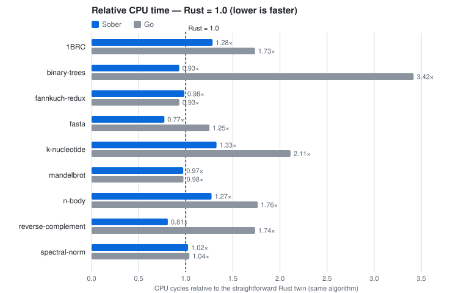
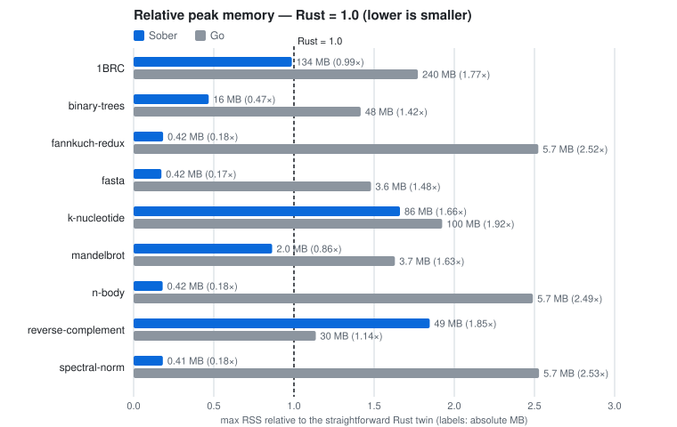

# Sober

English | [日本語](README.ja.md)

A value-oriented programming language.

A Sober program names only values and mutable bindings. There are no reference or pointer types. Nothing outside a block can point at a value inside it, so a value's lifetime is decided by its block (a region). Sober needs neither a GC nor a borrow checker. A program cannot observe whether an immutable value was copied or shared. Because of that, the implementation can choose how a value is passed and where it is placed. → [What value orientation is](docs/value-oriented.md)

Statically typed (with type inference), expression-oriented, AOT-compiled straight to a native static ELF. No GC. Go-like syntax.

```sober
// examples/collatz_par.sober
package main

import "std/iter"
import "std/task"

type TooLarge error {
    n int
}

// Collatz steps (expression-oriented: if has a value)
func steps(n int) (int, error?) {
    if n > 1000000000 {
        return 0, TooLarge{n: n}
    }
    mut x := n
    mut k := 0
    while x != 1 {
        x = if x % 2 == 0 { x / 2 } else { 3 * x + 1 }
        k += 1
    }
    return k, nil
}

func main() int {
    mut ns := mut []int{}
    for i <- iter.Range(1, 1000001) {
        ns = append(ns, i)
    }
    // a parallel Map — the output is the same for any number of workers
    ks, err := task.Map(ns, (n) => steps(n) catch -1)
    if err != nil {
        return 1
    }
    mut best := 0
    for k <- ks {
        if k > best {
            best = k
        }
    }
    println("longest: ${best}")
    return 0
}
```

An HTTP server takes only the standard library (TLS 1.3 is in std as well):

```sober
// examples/http_hello.sober
package main

import "std/http/server"
import "std/net"

func hello(r http.server.Request) http.server.Response {
    n := http.server.Param(r, "name")
    return http.server.Text("hello, ${if n != nil { n } else { "world" }}\n")
}

func app(c net.Conn) error? {
    rs := []http.server.Route{http.server.Route{method: "GET", path: "/hello/:name", handler: hello}}
    return http.server.ServeConn(c, (r) => http.server.Dispatch(rs, r))
}

func serve() error? {
    for l <- net.Listen("127.0.0.1:8080")? {
        net.Serve(l, app)?
    }
    return nil
}

func main() int {
    if serve() != nil {
        return 1
    }
    return 0
}
```

## Properties derived from value orientation

In Sober, value orientation means the following two promises (see [What value orientation is](docs/value-oriented.md) for more).

- A reference never becomes a value. There is no way to take an address or a reference and store it or pass it around.
- A program cannot observe whether an immutable value was copied or shared.

The following five properties are derived from these two.

- Escaping references cannot be written. A reference never becomes a value, so there is no way to form something that points into freed memory. A value's lifetime is decided by its block, and a value leaving a block is copied. Every block is a region ([rules](docs/spec/09-memory.ja.md), in Japanese). No GC and no borrow checker are needed.
- Data races cannot be written. A mutable value never crosses a task boundary. Only immutable values and channels can be passed into a parallel scope ([rules](docs/spec/10-concurrency.ja.md), in Japanese).
- There are no lifetime annotations and no borrowing rules. With no references, there is nothing to annotate. The only thing to learn is what you cannot write. The forms that cannot be written (shared mutable state outside a domain, escaping references) are compile errors.
- There is no etiquette for writing fast code. Whether a value is passed by reference or by copy, and where it is placed, is chosen by the implementation. It is not the programmer's choice, so straightforward code is the fastest form.
- Parallelism does not change the output. Tasks share no mutable state, so the output is the same bytes for any number of workers.

## Four pillars

### Safe

- Memory safety and freedom from data races, with no GC and no borrow checker. This is derived from value orientation (see the section above).
- Unhandled errors are rejected. Errors are sets of labels that the analyzer derives from the call graph, and public boundaries must declare them ([rules](docs/spec/07-errors.ja.md), in Japanese).

→ [Why safe](docs/design-notes/safe.md) (in Japanese)

### Fast

- Straightforward code is fast. This is derived from value orientation (see the section above). The mechanisms for speed live only inside the runtime and the compiler, and the Sober side of the benchmarks is kept to the straightforward form.
- Runtime speed on par with Rust. Against straightforward Rust using the same algorithms, across 9 sequential benchmarks: 4 wins, 3 ties, 2 losses (the losses are reverse-complement 1.47× and n-body 1.17×). Against Go: 6 wins, 3 ties, no losses. <!-- benchsync:readme-speed-en -->
- A memory footprint on par with Rust. There is no GC. Peak RSS is at or below Rust's in 8 of the 9 benchmarks (the exception is k-nucleotide). <!-- benchsync:readme-rss-en -->
- Tasks are light. Measured on 2026-10-10, [Skynet](bench/skynet) with 1.11 million tasks ran 5× faster than Go.

→ [Why fast](docs/design-notes/fast.md) (in Japanese)

### Plain

- Ordinary, expression-oriented procedural code. if / switch / blocks / for have values ([rules](docs/spec/04-expressions.ja.md), in Japanese). If you can read Go, you can read Sober.
- No methods, no type classes, no macros. This is a choice to keep the language small. Of these, the absence of methods can also be explained from value orientation (see "Why there are no methods" in [What value orientation is](docs/value-oriented.md)).

→ [Why plain](docs/design-notes/plain.md) (in Japanese)

### Minimal

- A single binary with zero dependencies. The compiler is one static ELF that depends on neither libc nor LLVM, and the executables it produces are static ELFs as well.
- The compiler is about 140,000 lines (excluding the development tools in `src/compiler/tools/`), plus about 34,000 for the standard library (non-test source, comments and blank lines included).
- Fully bootstrapped from Zig and source alone. Starting from stage1, a frozen compiler written in Zig, the source snapshots in `bootstrap/` are built in order until they produce the current compiler ([the full chain](bootstrap/chain.txt)). There is no seed binary.

→ [Why minimal](docs/design-notes/minimal.md) (in Japanese)

## What you stop thinking about

With Sober, the following are no longer the programmer's job:

- When to free memory — regions are derived from the structure of the program. Forgotten frees, double frees and use-after-free are not things to be careful about; they cannot be written
- Lifetime annotations — there are none. The shape of ownership is decided by the syntax
- Data races and lock discipline — values are immutable by default and mutable bindings are unique. "Forgot to take the lock" is not a concept here
- Whether parallelism changes the result — the output is byte-identical for any number of workers
- "Fast way to write it" folklore — the straightforward form is the fast form (where a gap remains, it is measured and treated as the language's homework)
- "It worked on my machine" — builds are reproducible and execution is deterministic; the class of unreproducible bugs is simply gone
- Async coloring — functions have no color. Write blocking-style code and the M:N runtime schedules it

## Benchmarks

<picture>
  <source media="(prefers-color-scheme: dark)" srcset="docs/assets/bench-speed-dark.svg">
  
</picture>

<picture>
  <source media="(prefers-color-scheme: dark)" srcset="docs/assets/bench-rss-dark.svg">
  
</picture>

The speed and memory charts are generated by `scripts/benchsync.sh` from [bench/data/official.tsv](bench/data/official.tsv), the single source of the benchmark numbers on this page (a gate checks that the charts and numbers match it). The numbers are CPU time (task-clock) measured on GitHub Actions (AMD EPYC 9V45 96-Core Processor) by `.github/workflows/bench-official.yml`; to reproduce locally: `scripts/bench.sh -n 3` → `bench/seqperf.sh -n 5 --rust`. The Go and Rust twins of each benchmark live in `bench/<benchmark>/go` and `bench/<benchmark>/rust`. Measurement conditions and rules are in [docs/bench.md](docs/bench.md) (in Japanese). <!-- benchsync:readme-repro-en -->

## Verification built in

The testing tools all ship in `sober`. Property-based testing (std/quick), fuzzing (`sober fuzz`), coverage (`sober test --cover`) and mutation testing (`sober test --mutate`) need no extra tool or plugin.

- Mutation testing weaves all mutants into one test build and picks one at run time. For each mutant, only the tests that reach it run. Tests are deterministic, so one run decides the verdict (no reruns to rule out flakiness).
- Fuzzing is coverage-guided: inputs that open a new branch seed the next ones.
- Failures reproduce. Counterexamples are shrunk to a minimal form, and the same code and seed give the same trials and the same counterexample on every run. `sober fuzz --sched` also varies the parallel schedule per trial, so order-dependent failures reproduce from a seed too.
- `sober watch` checks on every save and, once it passes, warms build and tests in the background and remembers the results. A `sober test` you type next just returns the remembered result when nothing has changed.

The tools' real output is in [Writing tests](docs/guide/testing.md) (all output on that page is checked against the real thing).

## Try it

You need: x86-64 Linux, [Zig 0.15.2](https://ziglang.org/download/), git.

```sh
git clone <this repository> sober && cd sober
(cd src/stage1 && zig build)      # stage1 (the frozen compiler written in Zig)
scripts/stage2.sh                 # build the bootstrap/ chain to produce the current compiler (stage2) — a few minutes the first time
bin/sober build examples/hello.sober -o hello && ./hello
```

For more: [Install](docs/guide/install.md) → [Your first program](docs/guide/first-program.md) → [Language tour](docs/guide/tour.md) → [Standard library guide](docs/guide/std.md).

## The verification net

A change to the compiler goes in only after passing every check of `scripts/gates.sh --full`: the self-compilation fixed point (stage3 ≡ stage4), golden tests, agreement of observations with and without optimization, comparison against the frozen Zig version, independent oracles (Go's UTF-8, GNU as), and comparison against a formal model in Lean (`lean/` — [details](docs/formal.md), in Japanese) with proofs of type safety and confluence of parallelism.

## As a research subject

Beyond the language itself, Sober is a test bench with several claims you can verify:

- Determinism as a language promise — "same input, same bytes" holds through arithmetic, printing and parallelism (the output is byte-identical for any number of workers). Few implementations give experiments on performance or semantics this kind of reproducible floor
- Region inference without annotations, measured — a closed world plus "memory details are derived from structure and declarations" ([details](docs/region-domain-pool.md), in Japanese), tested against whether zero lifetime annotations can still reach systems-language performance (`bench/` carries the subjects with Go and Rust twins). One contemporary answer to the region lineage of MLKit and Cyclone
- Mechanized conformance between the formal model and the implementation — the Lean small-step semantics (`lean/`) and the checker are compared continuously over hundreds of thousands of extracted vectors, with a desugaring reference implementation as a differential oracle. A living specimen for studying model/implementation divergence
- Turning non-functional requirements into functional ones — performance (instruction-count ratchets), memory (bounds derived from declarations) and time (constant-time testing) treated as checked contracts rather than hopes
- A case study in AI-driven development — most of this compiler was written by AI pairs under human design rulings. Decisions, discarded alternatives and verification records stay in the docs and the commit history, so the methodology itself — verification density setting the pace an agent can sustain — is open to observation

How it goes about solving these (the design moves):

- Constrain references to tree shapes — values are immutable by default, mutable bindings are unique, and data lives in a tree of regions. Removing aliasing graphs from the language turns ownership safety from something you prove into something whose failure modes cannot be written (recursive types joined on the same terms: a tree lives in one region — [rules](docs/spec/02-types.ja.md), in Japanese)
- Turn unobservability into representational freedom — addresses and memory layout are not observable from the language, so the compiler is free to choose representations, and many features can be added without touching the semantic core
- Make "no conditional constraints" a review criterion — rules of the form "you cannot B when A" are kept only when tied to a soundness theorem ([review criterion](docs/design-dev.md#審査基準), in Japanese). The growth of language complexity is itself managed by discipline
- Put cross-cutting concerns in boundary declarations, not expressions — memory budgets, wait bounds and (planned) numeric precision are declared at boundaries, then derived and checked, never mixed into expressions
- No sugar that cannot be written plainly — such features go to analyzer diagnostics, or get dropped
- The methodological bet: oracle density sets development speed — goldens, mutations, properties, differential oracles and formal-model conformance run as a standing net, and its density is treated as the main variable of development

## Documents

- [User guide](docs/guide/README.md) — from installation to the language tour
- [Standard library reference](docs/std/README.ja.md) — signatures and descriptions of the public declarations, generated from the doc comments (currently Japanese-first; an English version is planned for 1.0)
- [CLI reference](docs/cli/sober.md) — the commands, flags and environment variables of `sober` (generated by `sober doc --cli` from the command table)
- [Conformance](docs/conformance/README.md) — how std's protocols and cryptography conform to their standards (tables and numbers generated from the tests)
- [DESIGN.md](DESIGN.md) — the main design decisions (five pillars)
- [Design notes (Q&A)](docs/design-notes/) (in Japanese) — "why Y rather than X"
- [Left out on purpose](docs/design-notes/not-in-sober.md) (in Japanese) — what Sober decided not to have, as opposed to what is not built yet
- [Related work](docs/design-notes/related-work.md) (in Japanese) — for each mechanism, what Sober took from earlier research and languages, and what it changed
- [Language specification](docs/spec/README.ja.md) (in Japanese) — the rules for what is accepted and how accepted programs behave (rules only; examples are the real files in examples/)
- For developers (in Japanese): [decision record](docs/language.md), [syntax](docs/syntax.md), [IR](docs/ir.md), [formalization](docs/formal.md), [oracles](docs/oracles.md)

## What can you build with Sober?

Everything below is a real artifact in this tree:

- An HTTP/1.1 + TLS 1.3 server — the `std/http/server` entry sits alongside C / Rust / V implementations on the public [HttpArena](https://github.com/MDA2AV/HttpArena) leaderboard (`bench/httparena/`)
- This compiler itself — ~140K lines of self-hosted Sober, from lexing to x86-64 machine code and ELF emission, with no libc (`src/compiler/`)
- The standard library — JSON, gzip/deflate, TLS 1.3, an HTTP client (with certificate-chain verification), crypto (AES-GCM / SHA-256 / RSA / x25519 / password hashing), session tokens, a PostgreSQL client and the io_uring M:N runtime (`src/std/`)
- Developer tooling — the test runner, property-based testing, fuzzing, coverage, mutation testing and watch (the whole `sober test` stack is itself written in Sober as part of the compiler)
- Data-processing subjects — 1BRC and benchmarks-game problems, output-identical to their Go / Rust twins (`bench/`)
- ~980 small examples (including negative examples that the checker rejects) — the guide's kvstore and more (`examples/` — all output-checked by gates)

## What is already there

A list of the surface implemented as of v0.7. The full rules are in the [language specification](docs/spec/README.ja.md) (in Japanese), the signatures in the [std reference](docs/std/README.ja.md) (in Japanese).

Language:

- Expression-oriented: if / switch / blocks have values. Multiple values, pipes and holes, defer, type inference
- Types: slices, maps, structs, unions, nominal types, optionals (`T?`), generics, recursive types (declarations that refer back to themselves through slice / map elements, the contents of `T?`, or function types — [rules](docs/spec/02-types.ja.md), in Japanese)
- Bindings: const by default, mutation is explicit with `mut`, no shadowing, freeze
- Functions: lambdas, function values and closures, named arguments (no methods, type classes or macros)
- Errors: error types, `?`, `catch`, label sets derived and checked for exhaustiveness by the analyzer (`@errors`), distinct from panics
- Memory: regions (lifetime = the nesting of scopes), Pool, declared resource limits (budgets)
- Concurrency: structured concurrency (scopes and tasks), channels, deterministic parallelism, budgets and deadlines, leases, domains (serialized updates from many tasks to one state, with a bound on waiting; no locks in the source)
- Packages and imports: one directory = one package, the qualifier is every segment of the import path (`std/http/server` → `http.server.X`), and a `sober.mod` at the build root declares the module's name and its local dependencies ([rules](docs/spec/08-packages.ja.md), in Japanese)
- Annotations: `@embed`, `@layout`, secret-value tracking, and more
- Testing: `sober test` and assert (prints the values of subexpressions and the assert's position when false; an optional label `assert(e, label)`), property-based testing with std/quick, `sober fuzz`, `--cover` (coverage), `--mutate` (mutation testing), build-time substitution (a test's `@doubles` names a double — `*_double.sober` — that its build reads in place of the real package; signatures, types and effects are checked against the real declarations)

Standard library (33 packages — signatures and descriptions in the [std reference](docs/std/README.ja.md)):

- I/O and networking: io, os, net (TCP, a stub DNS resolver), http/server (an HTTP/1.1 server, SSE, multipart, cookies), http/client (an HTTP/1.1 client — TLS 1.3 by default, the certificate chain always verified), tls (a TLS 1.3 server), url, session (signed session tokens), time (wall clock and monotonic clock, RFC 3339 / HTTP-date, time zones), cli (a CLI declared as a table), env (a table of declared environment variables), pg (a PostgreSQL client — wire protocol 3.0, TLS / SCRAM, transactions, a connection pool)
- Cryptography and hashing: crypto (AES-GCM, ChaCha20-Poly1305, SHA-256, HMAC, HKDF, X25519, RSA, PEM, password hashing — Argon2id, bcrypt, PBKDF2 — cryptographic randomness, constant-time operations), hash (crc32, sha256), uuid (v4 / v7)
- Encoding and conversion: json, base64, hex, binary, convert, strings, utf8, compress (flate / gzip encoding and decoding)
- Data and computation: iter, sort, math, rand, table, builder, pool, layout
- Parallelism and testing: task (a deterministic parallel Map, domains, among others), testing (cell — state that test doubles keep), quick (property-based testing)

Tools (subcommands of the single `sober` binary):

- `build` (with intermediate outputs via `--emit=ll|ir|elf`), `run`, `check` (type-check and analyze without building), `test` (`--cover`, `--mutate`, `--wiring`), `fuzz`, `watch` (checks on every save and warms build and tests in the background), `fmt`, `iface` (print a package's public surface), `fix` (write derived `@effects` / `@errors` declarations), `outline` (declarations and their line ranges), `doc --cli`, `cache`
- `check`, `build` and `test` remember the answer to a query and return it when the same query comes again; after an edit they redo only the changed functions and packages (the caches are on by default)

## Roadmap — not yet implemented

The core language surface is stable. 1.0 means "the language's promises are frozen" — the start of the compatibility contract; until then, breaking changes can happen. No dates are promised, for the items listed here or for 1.0.

Standard library (features to implement before 1.0):

- [ ] More compression algorithms
- [x] ECDSA verification and X.509 certificate-chain verification (used by the HTTP client's TLS)
- [ ] TLS features for operations (certificate reload, client authentication, session resumption)
- [x] Database clients: PostgreSQL (wire protocol 3.0, TLS / SCRAM, transactions, a connection pool)
- [ ] Database clients: MySQL
- [x] An HTTP client (HTTP/1.1, TLS 1.3 / 1.2, proxy CONNECT)
- [ ] Full coverage of HTTP/1.1
- [ ] The missing halves of one-sided API pairs
- [ ] Regular expressions (design under consideration)
- [ ] Broader test coverage of std

Language and compiler:

- [x] Floating-point completeness (a single float type, IEEE 754 binary64 — bit-deterministic arithmetic and printing, no libm)
- [x] Recursive data types (recursion through `[]T` / `map[K]T` elements, the contents of `T?`, or function types, including mutual recursion and generic recursive unions — design in section 1 of [language.md](docs/language.md), in Japanese)
- [x] Closures that carry mutable state (locally-bound lambdas capture `mut` bindings by inlining; function types take explicit `mut` parameters — capturing `mut` into a function *value* was deliberately rejected)
- [x] Long-lived shared state (domains — serialized updates, bounded waits, no locks in the source)
- [ ] Merging value streams (zip)
- [ ] A stronger analyzer: better diagnostics and lints
- [ ] Effect tracking: bring the effects now described by separate mechanisms (errors, mut, identity, …) into a single framework (design under consideration)
- [x] Incremental compilation
- [x] The import system: the qualifier is the whole path, and `sober.mod` declares the module and its local dependencies
- [ ] Pure Sober bootstrap: fold the multi-stage bootstrap chain, which mirrors the language's development history, into a small seed compiler plus a few steps — so Sober builds from source with Sober alone, without going through Zig
- [ ] Cross-compilation (macOS, Windows, other CPUs)

Tools:

- [x] sober watch (a development loop that checks on every save and warms build and tests in the background)
- [ ] Package management (fetching, versions, a registry — the declaration's shape is already fixed by `sober.mod`)
- [ ] A language server (LSP)
- [ ] Refactoring support
- [ ] A profiler
- [ ] Structured documentation, and English versions of the specification and the std reference

Further out:

- [ ] WebAssembly
- [ ] GPU kernels (a subset of the language compiled to SPIR-V)
- [ ] Unikernel targets
- [ ] Optimizations that carry proofs
- [ ] Type-checked SQL

## License

Licensed under either of MIT or Apache-2.0, at your option (`LICENSE-MIT`, `LICENSE-APACHE`). The standard library and the runtime are under the same terms, and no restrictions are placed on the executables you produce.

## Acknowledgements

The benchmarks are based on the problem specifications of [The Computer Language Benchmarks Game](https://benchmarksgame-team.pages.debian.net/benchmarksgame/) and on [The One Billion Row Challenge](https://github.com/gunnarmorling/1brc) (in every language, the implementations were written in a straightforward form from the specification). JSON is tested with [JSONTestSuite](https://github.com/nst/JSONTestSuite) (MIT), and the cryptography with the test vectors of [Wycheproof](https://github.com/C2SP/wycheproof) (Apache-2.0). The HTTP server is tested and measured with the dataset, test certificate and load profiles of [HttpArena](https://github.com/MDA2AV/HttpArena) (MIT). See `NOTICE` for the third-party files in this repository.
