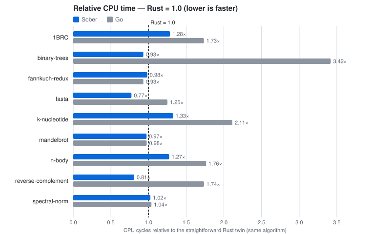
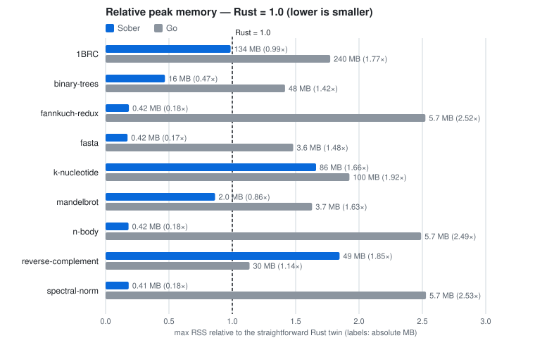

# Sober

English | [日本語](README.ja.md)

A minimal, fast, safe and plain programming language.

```sober
// examples/collatz_par.sober
package main

import "std/iter"
import "std/task"

type TooLarge error {
    n int
}

// Collatz steps (expression-oriented: if has a value)
func steps(n int) (int, error?) {
    if n > 1000000000 {
        return 0, TooLarge{n: n}
    }
    mut x := n
    mut k := 0
    while x != 1 {
        x = if x % 2 == 0 { x / 2 } else { 3 * x + 1 }
        k += 1
    }
    return k, nil
}

func main() int {
    mut ns := mut []int{}
    for i <- iter.Range(1, 1000001) {
        ns = append(ns, i)
    }
    // a parallel Map — the output is the same for any number of workers
    ks, err := task.Map(ns, (n) => steps(n) catch -1)
    if err != nil {
        return 1
    }
    mut best := 0
    for k <- ks {
        if k > best {
            best = k
        }
    }
    println("longest: ${best}")
    return 0
}
```

> Status: v0.6.0. The core language surface is stable. The big remaining items are floating point and platforms (macOS, Windows, cross-compilation); today it runs only on x86-64 Linux. 1.0 will mean "the language's promises are frozen" — until then, details may change.

## Four pillars

### Minimal

- A single binary with zero dependencies. The compiler is one static ELF that depends on neither libc nor LLVM, and the executables it produces are static ELFs as well.
- The compiler is under 100,000 lines: about 97,000, plus about 11,000 for the standard library (non-test source, comments and blank lines included).
- Fully bootstrapped from Zig and source alone. Starting from stage1, a frozen compiler written in Zig, the source snapshots in `bootstrap/` are built in order until they produce the current compiler. There is no seed binary.

→ [Why minimal](docs/design-notes/minimal.md) (in Japanese)

### Fast

- Runtime speed on par with Rust. Against straightforward Rust using the same algorithms, across 9 sequential benchmarks: 4 wins, 3 ties, 2 losses (the losses are reverse-complement 1.47× and n-body 1.17×). Against Go: 6 wins, 3 ties, no losses. <!-- benchsync:readme-speed-en -->
- A memory footprint on par with Rust. There is no GC. Peak RSS is at or below Rust's in 8 of the 9 benchmarks (the exception is k-nucleotide). <!-- benchsync:readme-rss-en -->
- High parallel performance — and deterministic. Structured-concurrency tasks are light (Skynet with 1.11 million tasks runs 5× faster than Go — measured 2026-10-10), and the output is the same bytes for any number of workers.

→ [Why fast](docs/design-notes/fast.md) (in Japanese)

### Safe

- Memory safety and freedom from data races, with no GC and no borrow checker. Lifetimes match the nesting of scopes (every block is a region), and only immutable values and channels can be passed into a parallel scope.
- Unhandled errors are rejected. Errors are sets of labels that the analyzer derives from the call graph, and public boundaries must declare them.
- The only thing to learn is what you cannot write. There are no lifetime annotations and no borrowing rules; the forms that cannot be written (shared mutable state, escaping references) are simply compile errors.

→ [Why safe](docs/design-notes/safe.md) (in Japanese)

### Plain

- Ordinary, expression-oriented procedural code. if / switch / blocks / for have values, and there are no methods, type classes or macros. If you can read Go, you can read Sober.
- There is no etiquette for writing fast code. Straightforward code is the fastest form. The mechanisms for speed live only inside the runtime and the compiler, and the Sober side of the benchmarks is kept to the straightforward form.

→ [Why plain](docs/design-notes/plain.md) (in Japanese)

## Benchmarks

<picture>
  <source media="(prefers-color-scheme: dark)" srcset="docs/assets/bench-speed-dark.svg">
  
</picture>

<picture>
  <source media="(prefers-color-scheme: dark)" srcset="docs/assets/bench-rss-dark.svg">
  
</picture>

The speed and memory charts are generated by `scripts/benchsync.sh` from [bench/data/official.tsv](bench/data/official.tsv), the single source of the benchmark numbers on this page (a gate checks that the charts and numbers match it). The numbers are CPU time (task-clock) measured on GitHub Actions (AMD EPYC 9V45 96-Core Processor) by `.github/workflows/bench-official.yml`; to reproduce locally: `scripts/bench.sh -n 3` → `bench/seqperf.sh -n 5 --rust`. The Go and Rust twins of each benchmark live in `bench/<benchmark>/go` and `bench/<benchmark>/rust`. Measurement conditions and rules are in [docs/bench.md](docs/bench.md) (in Japanese). <!-- benchsync:readme-repro-en -->

## Try it

You need: x86-64 Linux, [Zig 0.15.2](https://ziglang.org/download/), git.

```sh
git clone <this repository> sober && cd sober
(cd src/stage1 && zig build)      # stage1 (the frozen compiler written in Zig)
scripts/stage2.sh                 # build the bootstrap/ chain to produce the current compiler (stage2) — a few minutes the first time
bin/sober build examples/hello.sober -o hello && ./hello
```

For more: [Install](docs/guide/install.md) → [Your first program](docs/guide/first-program.md) → [Language tour](docs/guide/tour.md) → [Standard library guide](docs/guide/std.md).

## The verification net

A change to the compiler goes in only after passing every check of `scripts/gates.sh --full`: the self-compilation fixed point (stage3 ≡ stage4), golden tests, agreement of observations with and without optimization, comparison against the frozen Zig version, independent oracles (Go's UTF-8, GNU as), and comparison against a formal model proved in Lean (`lean/` — type safety and confluence of parallelism).

## Documents

- [User guide](docs/guide/README.md) — from installation to the language tour
- [Standard library reference](docs/std/README.ja.md) — signatures and descriptions of the public declarations, generated from the doc comments (currently Japanese-first; an English version is planned for 1.0)
- [DESIGN.md](DESIGN.md) — the main design decisions (five pillars)
- [Design notes (Q&A)](docs/design-notes/) (in Japanese) — "why Y rather than X"
- [Language specification](docs/spec/README.ja.md) (in Japanese) — the rules for what is accepted and how accepted programs behave (rules only; examples are the real files in examples/)
- For developers (in Japanese): [decision record](docs/language.md), [syntax](docs/syntax.md), [IR](docs/ir.md), [formalization](docs/formal.md), [oracles](docs/oracles.md)

## Roadmap — not yet implemented

1.0 marks the start of the compatibility contract; until then, breaking changes can happen. No dates are promised.

Standard library — features to implement before 1.0:

- [ ] Decompression (inflate / gunzip) and more compression algorithms
- [ ] More cryptography: ECDSA, and TLS features for operations (certificate reload, client authentication, session resumption)
- [ ] Database clients: PostgreSQL and MySQL
- [ ] An HTTP client, and full coverage of HTTP/1.1
- [ ] The missing halves of one-sided API pairs
- [ ] Regular expressions (design under consideration)
- [ ] Broader test coverage of std

Language and compiler:

- [ ] Recursive data types
- [ ] Closures that capture mut bindings
- [ ] Merging value streams (zip)
- [ ] A stronger analyzer: better diagnostics and lints
- [ ] Effect tracking: bring the effects now described by separate mechanisms (errors, mut, identity, …) onto a single surface (design under consideration)
- [ ] Incremental compilation
- [ ] Cross-compilation (macOS, Windows, other CPUs)

Tools:

- [ ] Package management
- [ ] A language server (LSP)
- [ ] Refactoring support
- [ ] Watch mode
- [ ] A profiler
- [ ] Structured documentation, and English versions of the specification and the std reference

Further out:

- [ ] WebAssembly
- [ ] GPU kernels (a subset of the language compiled to SPIR-V)
- [ ] Unikernel targets
- [ ] Optimizations that carry proofs
- [ ] Type-checked SQL

## License

Licensed under either of MIT or Apache-2.0, at your option (`LICENSE-MIT`, `LICENSE-APACHE`). The standard library and the runtime are under the same terms, and no restrictions are placed on the executables you produce.

## Acknowledgements

The benchmarks are based on the problem specifications of [The Computer Language Benchmarks Game](https://benchmarksgame-team.pages.debian.net/benchmarksgame/) and on [The One Billion Row Challenge](https://github.com/gunnarmorling/1brc) (in every language, the implementations were written in a straightforward form from the specification). JSON is tested with [JSONTestSuite](https://github.com/nst/JSONTestSuite) (MIT), and the cryptography with the test vectors of [Wycheproof](https://github.com/C2SP/wycheproof) (Apache-2.0). The HTTP server is tested and measured with the dataset, test certificate and load profiles of [HttpArena](https://github.com/MDA2AV/HttpArena) (MIT). See `NOTICE` for the third-party files in this repository.
